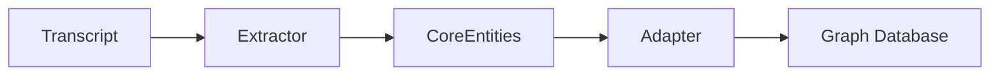

# RAG & Entity Extraction Module

The RAG module (`src/journal_utilities/rag/`) extracts structured knowledge from transcripts to power downstream applications like the Chat Engine and Knowledge Graph.

## Architecture

The data flows through a linear pipeline:



## Components

### 1. Extractor (`extractors/`)

Uses LLMs to extract entities from raw text.

- **`CohereExtractor`**: Uses Cohere's Command models to Identify entities (People, Concepts, etc.) and their relationships.
- **Input**: Raw text chunk (approx 2000-4000 tokens).
- **Output**: JSON object matching `CoreEntities` schema.

### 2. Schema (`schemas/`)

Defines the ontology for extraction.

- **Entities**: `Person`, `Organization`, `Concept`, `Publication`, `Event`, `Location`, `Theory`, `Methodology`.
- **Relationships**: `authored`, `proposed`, `criticized`, `collaborated_with`, etc.

### 3. Graph Client (`graph/`)

Manages interaction with SurrealDB.

- **Nodes**: Entity records are identified by trusted transcript source, entity type and name.
- **Edges**: Relationships reference the returned entity record IDs, not generic display names.
- **Idempotency**: Scoped records and deterministic relationship identities are reused on replay.
- **SDK**: `surrealdb>=3.0.0` (the async-client generation). `SurrealDBClient` opens the
  connection with `AsyncSurreal`, types it as `AsyncSurrealConnection`, and awaits
  `connect()` / `signin()` / `use()` / `query()` / `close()`. `query()` answers one entry
  per statement, so single-statement queries are unwrapped to their rows
  (`_first_statement`) before use. The qualified 3.0.0 SDK returns a single record
  mapping from `create()` and singular-endpoint `relate()`, not a list.
  The source-identity migration was exercised against SurrealDB 4.0.1; this is
  not a qualification of every server version accepted by the SDK.

## Pipeline (`main.py`)

The `JournalRAGPipeline` class orchestrates the process:

1. **`process_transcript(transcript)`**:
    - Creates a `Transcript` record in DB.
    - Calls `extractor.extract_core_entities()`.
    - Converts results via `EntityAdapter`.
    - Upserts entities and relationships to SurrealDB.

## Usage

```bash
# Select pending database transcripts; resolve their relative paths under the corpus
make extract-entities RAG_BASE_PATH=/path/to/corpus
```

## Configuration

| Variable | Description |
| :--- | :--- |
| `COHERE_API_KEY` | API Key for Cohere AI |
| `COHERE_MODEL` | Model ID (default `command-a-03-2025`, from `rag/settings.py`) |
| `DB_URL` | SurrealDB connection string |

## Explicit extraction and source identity

Select files with `python -m journal_utilities.rag.main --file transcript.txt [more.txt ...]`
or pending database work with `python -m journal_utilities.rag.main --pending --base-path /path/to/corpus`.
No selection is a usage error (exit 2). Requested failures return exit 1;
successful runs, including an explicitly selected empty pending queue, return 0
and print processed/failed/entity/relationship totals. Extraction needs Cohere
credentials and SurrealDB; an empty queue does not construct the provider client.

Relationship endpoints are checked against the trusted source-qualified entity
identity. Missing required endpoints or failed edge writes leave the transcript
pending. Retry and replay reuse persisted records rather than duplicating edges.
Generic names or metadata claims never establish provenance for unknown-source
legacy records. File and database loaders use a valid filename date, otherwise
`datetime.min`; retries preserve stored historical dates.

## Legacy schema migration

Take a reviewed backup and stop concurrent writers before explicitly running
`python -m journal_utilities.rag.main --migrate-source-identity`.
Ordinary connection refuses a legacy schema rather than silently migrating it.
The migration changes schema, preserves records and performs no Cohere request.
It refuses ambiguous identities or contradictory attributed endpoints; it does
not backfill provenance. Qualify it against a disposable database before any
production migration.
